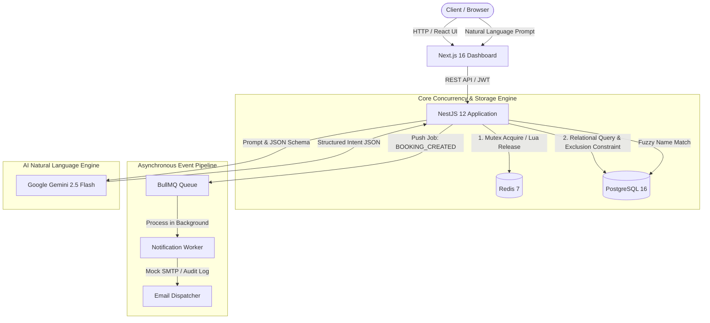

# Enterprise Workspace & Asset Management System

[](https://github.com/king11ww/enterprise-workspace-system/actions)
[](LICENSE)
[](https://nodejs.org/)
[](https://nestjs.com/)
[](https://nextjs.org/)
[](https://redis.io/)
[](https://ai.google.dev/)

An enterprise-grade workspace and resource reservation platform engineered with **high-concurrency race condition control**, **asynchronous message queues**, and **AI-powered natural language booking**.

---

## 🏛️ System Architecture



---

## 🚀 Key Technical Highlights

### 1. Dual-Layer Race Condition & Double-Booking Elimination
When multiple users attempt to reserve the same room at the exact same millisecond:
* **Primary Layer (Redis Distributed Mutex):** Employs atomic `SET key token NX PX 5000` with unique UUID ownership tokens and Lua script safe release (`if get(key) == token then del(key)`). Requests unable to acquire the lock receive `409 Conflict`.
* **Secondary Layer (PostgreSQL Exclusion Constraint):** Utilizes `btree_gist` extension to enforce mathematical non-overlapping intervals:
  ```sql
  ALTER TABLE "bookings" ADD CONSTRAINT "bookings_no_overlap"
  EXCLUDE USING gist (
    "resource_id" WITH =,
    tsrange("start_time", "end_time", '[)') WITH &&
  ) WHERE ("status" <> 'CANCELLED');
  ```
  Verified by concurrency stress tests: **50 concurrent requests simultaneously targeting 1 slot result in exactly 1 success (201 Created) and 49 safe rejections (409 Conflict)**.

### 2. Sub-50ms API Latency via BullMQ Asynchronous Workers
* Confirmation emails and notifications are decoupled from the synchronous HTTP request-response cycle.
* When a booking transaction commits, a lightweight job is pushed to the `notifications` BullMQ queue with exponential backoff retry.
* The API returns to the client in **~30ms**, while background workers handle email formatting and dispatch.

### 3. Google Gemini AI Natural Language Booking
* Endpoint: `POST /api/ai/parse-intent`
* Employs **Gemini 2.5 Flash** with **Native Structured Outputs (JSON Schema)** to extract:
  * `resourceName`: Target meeting room, desk, or equipment
  * `startTime`: ISO 8601 timestamp
  * `durationMinutes`: Reservation length
* Automated resource matching pairs the intent with available assets in PostgreSQL to deliver ready-to-book payloads for the client.

---

## 🛠️ Tech Stack

| Layer | Technologies |
| :--- | :--- |
| **Frontend** | Next.js 16 (Turbopack, App Router), React 19, Vanilla CSS Glassmorphism |
| **Backend** | NestJS 12, TypeScript, Express, Passport JWT, Class Validator, Swagger OpenAPI |
| **Database & ORM** | PostgreSQL 16 (Alpine), Prisma ORM 6.4, `btree_gist` Exclusion Constraints |
| **Caching & Locking** | Redis 7 (Alpine), `ioredis`, Atomic Distributed Mutex |
| **Message Queue** | BullMQ, Redis Streams, Background Consumer Workers |
| **AI Integration** | Google Gen AI SDK (`@google/genai`), Gemini 2.5 Flash Structured Outputs |
| **DevOps & CI/CD** | Docker Multi-stage Builds, Docker Compose, GitHub Actions |

---

## ⚡ Quick Start with Docker (Recommended)

Run the entire platform with one command:

```bash
# 1. Clone repository
git clone https://github.com/king11ww/enterprise-workspace-system.git
cd enterprise-workspace-system

# 2. Copy environment variables
cp .env.example .env

# 3. Boot all services (Frontend, Backend, PostgreSQL, Redis)
docker compose up -d --build
```

Access the services:
* **Web Dashboard:** [http://localhost:3000](http://localhost:3000)
* **REST API:** [http://localhost:3001/api](http://localhost:3001/api)
* **Interactive Swagger API Docs:** [http://localhost:3001/api/docs](http://localhost:3001/api/docs)

---

## 🧑‍💻 Default Demo Accounts

The database comes pre-seeded with sample users across all RBAC tiers:

| Role | Email | Password | Permissions |
| :--- | :--- | :--- | :--- |
| **ADMIN** | `admin@enterprise.local` | `AdminPassword123!` | Full system administration, delete resources, all audit logs |
| **MANAGER** | `manager@enterprise.local` | `ManagerPassword123!` | Create/edit resources, cancel any booking, manage facilities |
| **EMPLOYEE** | `employee@enterprise.local` | `EmployeePassword123!` | Book resources, view/cancel own reservations |

---

## 💻 Local Development Setup

If you wish to run without Docker:

```bash
# 1. Start Postgres & Redis
docker compose up -d postgres redis

# 2. Setup Backend
cd backend
npm install
npx prisma migrate dev
npm run start:dev

# 3. Setup Frontend (in another terminal)
cd frontend
npm install
npm run dev
```

---

## 📡 API Reference Overview

| Method | Endpoint | Description | Access |
| :--- | :--- | :--- | :--- |
| `POST` | `/api/auth/login` | Authenticate user & issue JWT token pair | Public |
| `POST` | `/api/auth/register` | Register new employee account | Public |
| `GET` | `/api/auth/me` | Fetch authenticated user profile | Authenticated |
| `GET` | `/api/resources` | List resources with search, filter, pagination | Authenticated |
| `POST` | `/api/resources` | Create a new asset | `ADMIN`, `MANAGER` |
| `DELETE` | `/api/resources/:id` | Delete asset (with active booking safety check) | `ADMIN` |
| `POST` | `/api/bookings` | Reserve asset with Redis Distributed Lock | Authenticated |
| `GET` | `/api/bookings` | Query bookings (employees scoped to own bookings) | Authenticated |
| `PATCH` | `/api/bookings/:id/cancel` | Cancel an active booking & trigger queue | Owner, `MANAGER`, `ADMIN` |
| `POST` | `/api/ai/parse-intent` | Parse natural language prompt with Gemini AI | Authenticated |

---

## 🧪 Testing

```bash
# Run backend unit & integration tests
cd backend
npm run test

# Run build verification
npm run build
```

---

## 📄 License

This project is licensed under the MIT License - see the [LICENSE](LICENSE) file for details.
